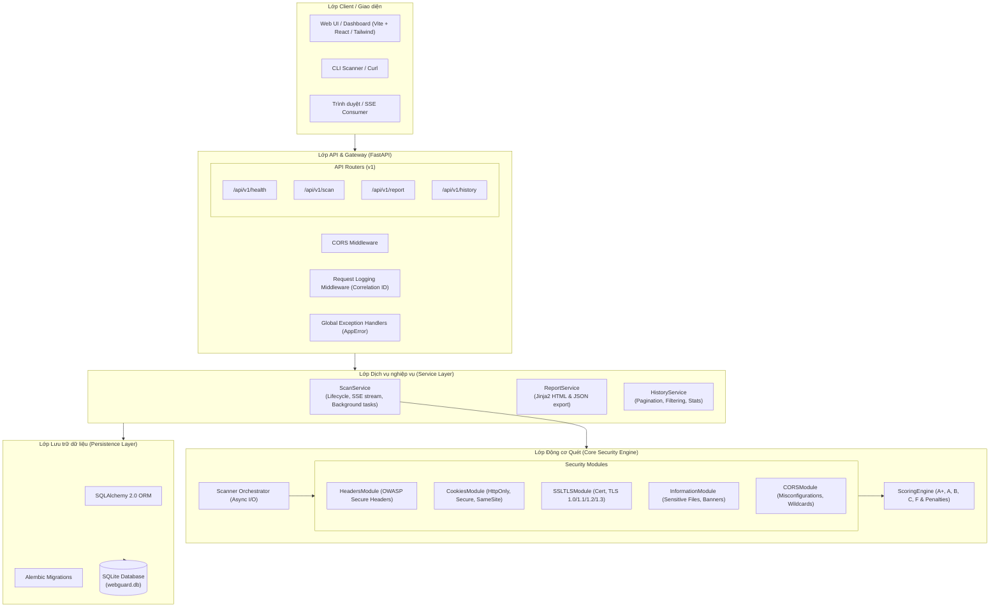
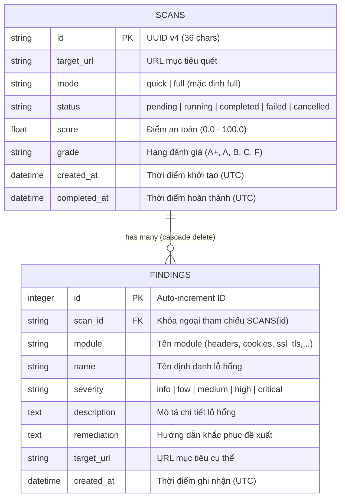
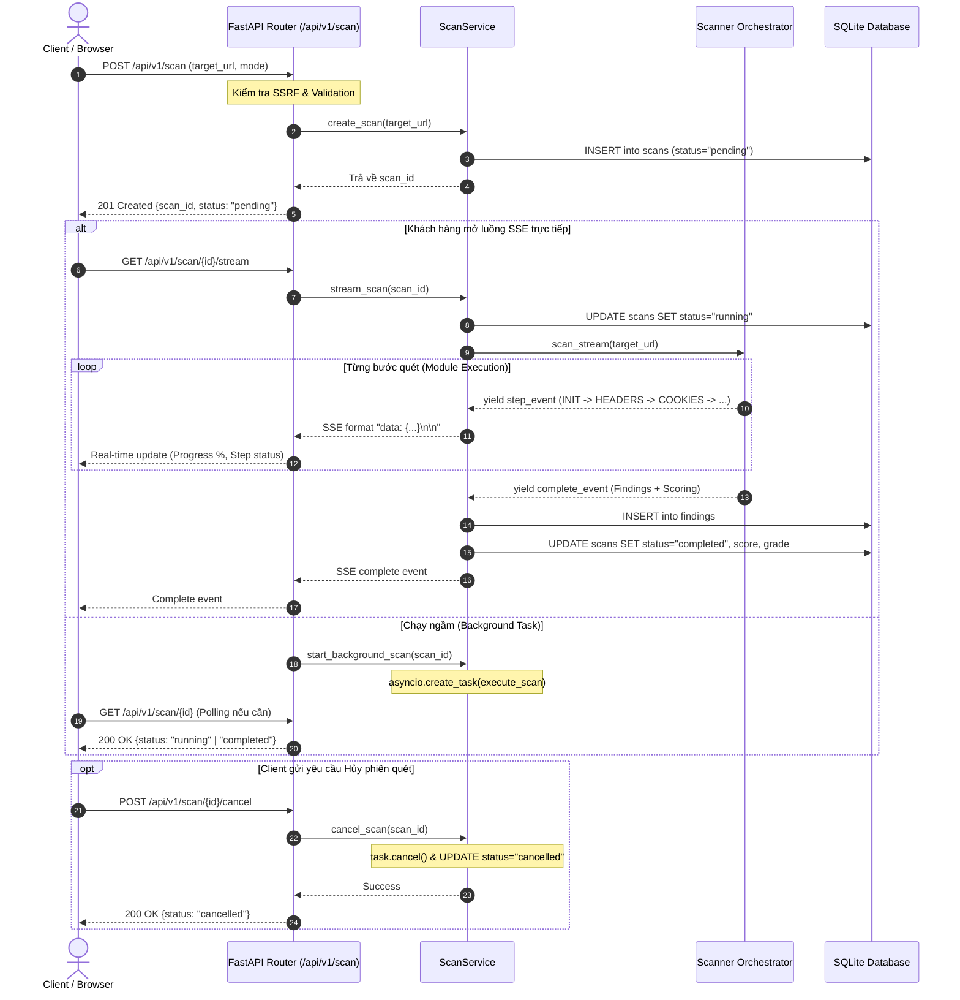

# WebGuard Architecture Document

Tài liệu thiết kế kiến trúc toàn diện của dự án **WebGuard (Web Security Assessment & Misconfiguration Scanner)**, tuân thủ tiêu chuẩn DevSecOps và quy chuẩn phát triển phần mềm doanh nghiệp (Enterprise Grade).

---

## 1. Tổng quan hệ thống (System Overview)

WebGuard là công cụ đánh giá an ninh mạng và phát hiện lỗi cấu hình tự động cho các ứng dụng web. Hệ thống được thiết kế theo kiến trúc phân lớp (Layered Architecture) với tính phân tách rõ ràng (Separation of Concerns), xử lý bất đồng bộ (Asynchronous I/O) và hỗ trợ truyền dữ liệu thời gian thực (Server-Sent Events - SSE).

### Sơ đồ kiến trúc mức cao (High-Level Architecture)



---

## 2. Mô hình Dữ liệu (Data Architecture & Database Models)

Hệ thống lưu trữ dữ liệu các phiên quét và danh sách lỗ hổng phát hiện được thông qua cơ chế quan hệ **1-N (One-to-Many)** giữa hai thực thể: `ScanModel` và `FindingModel`.

### Sơ đồ Quan hệ Thực thể (Entity Relationship Diagram - ERD)



### Thiết kế Bảng & Indexing
- **Khóa chính UUID**: `scans.id` dùng chuỗi UUID v4 giúp bảo mật ID, chống ID Enumeration Attack.
- **Ràng buộc toàn vẹn & Cascade Delete**: Khi xóa một bản ghi trong `scans`, toàn bộ các bản ghi con trong `findings` được tự động dọn dẹp nhờ `ondelete="CASCADE"`.
- **Database Indexing**:
  - `ix_scans_id`, `ix_scans_target_url`, `ix_scans_status`, `ix_scans_created_at` hỗ trợ tăng tốc độ lọc và phân trang trong `HistoryService`.
  - `ix_findings_id`, `ix_findings_scan_id`, `ix_findings_severity` tối ưu truy vấn danh sách lỗi theo phiên quét.

---

## 3. Vòng đời Quét & Kiến trúc Streaming (SSE & Async Lifecycle)

Quy trình quét an ninh mạng đòi hỏi thời gian thực thi I/O mạng từ vài giây đến hàng chục giây. WebGuard áp dụng mô hình bất đồng bộ không chặn (Non-blocking Asynchronous Execution) kết hợp Server-Sent Events (SSE).

### Sơ đồ Tuần tự Vòng đời Quét (Sequence Diagram)



---

## 4. Kiến trúc Bảo mật (Security Architecture)

Hệ thống được thiết kế theo nguyên tắc "Secure by Default" nhằm bảo vệ chính máy chủ WebGuard:

1. **Phòng chống SSRF (Server-Side Request Forgery)**:
   - Hai lớp kiểm tra: (1) `ScanCreateRequest` kiểm tra cú pháp, `localhost` và IP literal bằng `ipaddress` (`is_global`); (2) `assert_public_target` (`app/core/security.py`) phân giải DNS của hostname **không chặn event loop** và từ chối nếu *bất kỳ* địa chỉ nào không phải IP public.
   - Chặn các địa chỉ nội bộ (Private IPs: `10.0.0.0/8`, `172.16.0.0/12`, `192.168.0.0/16`), Loopback (`127.0.0.1`, `::1`), Link-local (`169.254.0.0/16`, gồm Cloud Metadata `169.254.169.254`), CGNAT, reserved.
   - Giới hạn đã biết: kiểm tra diễn ra lúc tạo scan nên không chống hoàn toàn DNS rebinding; module không theo redirect (`follow_redirects` mặc định tắt) và mọi request tới mục tiêu có timeout 10 giây.

2. **Cấu hình CORS & An toàn Middleware**:
   - `CORSMiddleware` cấu hình các Origin được phép truy cập theo biến môi trường `ALLOWED_HOSTS`.
   - `RequestLoggingMiddleware` tự động sinh mã định danh duy nhất `X-Correlation-ID` cho mỗi HTTP request để hỗ trợ truy vết lỗi (Distributed Tracing).

3. **Global Exception Handling (RFC 7807 Standard)**:
   - Các ngoại lệ nghiệp vụ thừa kế từ `AppError` (`NotFoundError`, `ValidationError`, `ScanExecutionError`) luôn trả về payload JSON có cấu trúc chuẩn mực:
     ```json
     {
       "error": {
         "code": "NOT_FOUND",
         "message": "Không tìm thấy phiên quét có ID: ...",
         "status_code": 404
       }
     }
     ```

---

## 5. Cấu trúc Thư mục & Mô đun Hóa (Directory Structure)

```text
backend/
├── app/
│   ├── api/                    # Lớp HTTP Routers
│   │   └── v1/
│   │       ├── health.py       # Health check, liveness & readiness probes
│   │       ├── scan.py         # Quản lý phiên quét & SSE streaming
│   │       ├── report.py       # Báo cáo kết quả (HTML/JSON export)
│   │       └── history.py      # Lịch sử quét, phân trang và thống kê
│   ├── core/                   # Cấu hình lõi & Middleware
│   │   ├── config.py           # Pydantic Settings
│   │   ├── errors.py           # Custom Exceptions & Handlers
│   │   ├── logging.py          # Loguru Structured Logger
│   │   └── middleware.py       # Correlation ID & Timing Middleware
│   ├── db/                     # Lớp CSDL
│   │   ├── session.py          # SQLAlchemy Engine, SessionLocal & get_db
│   │   └── migrations/         # Alembic Migrations
│   ├── models/                 # SQLAlchemy ORM Models
│   │   ├── scan.py             # ScanModel
│   │   └── finding.py          # FindingModel
│   ├── modules/                # Core Security Scanning Modules
│   │   ├── base.py             # BaseScannerModule
│   │   ├── headers.py          # HeadersModule
│   │   ├── cookies.py          # CookiesModule
│   │   ├── ssl_tls.py          # SSLTLSModule
│   │   ├── information.py      # InformationModule
│   │   ├── cors.py             # CORSModule
│   │   ├── scanner.py          # Scanner Orchestrator
│   │   └── scoring.py          # ScoringEngine
│   ├── schemas/                # Pydantic Request/Response DTOs
│   │   ├── scan.py             # ScanRequest, ScanResponse, ScanEvent
│   │   └── history.py          # HistoryQuery, PaginatedHistory, HistoryStats
│   ├── services/               # Lớp Dịch vụ nghiệp vụ (Business Services)
│   │   ├── scan.py             # ScanService
│   │   ├── report.py           # ReportService
│   │   └── history.py          # HistoryService
│   └── main.py                 # FastAPI Application Entrypoint
└── tests/                      # Kiểm thử tự động (Pytest)
    ├── unit/                   # Unit tests cho Modules & Services
    └── integration/            # Integration & E2E API tests
```

---

## 6. Kiến trúc Frontend (React + Vite + TypeScript)

```text
frontend/src/
├── App.tsx              # Điều hướng giữa các view, lazy-load Results/About
├── config.ts            # API_BASE_URL, USE_MOCK (VITE_USE_MOCK)
├── components/          # common (Button, Card, Badge, ProgressBar, Modal), layout, results, scanner
├── pages/               # ScanPage, ResultsPage, HistoryPage, AboutPage
├── hooks/
│   ├── useSSE.ts        # EventSource (không tự reconnect) hoặc mô phỏng mock
│   ├── useScan.ts       # Vòng đời quét: tạo scan -> stream -> kết quả / lỗi / hủy
│   ├── useHistory.ts    # Lịch sử: lọc, sắp xếp, phân trang, thống kê, xóa (server-side)
│   └── useReport.ts     # Xuất báo cáo: ưu tiên server, fallback client-side
├── services/            # apiClient (Axios + ApiError), scanApi, reportApi, mappers (DTO -> domain)
├── types/               # scan.ts (domain), api.ts (DTO khớp schemas backend)
└── utils/               # exportReport (JSON/HTML), mockScan / mockHistory (chế độ demo)
```

- **Luồng quét thật:** `useScan.startScan` -> `POST /scan` (kèm `mode`) -> mở `EventSource` tới `/scan/{id}/stream` -> map sự kiện `module_start` / `module_completed` / `complete` thành trạng thái UI. Lỗi tạo scan, lỗi stream hay mất kết nối đều chuyển UI sang trạng thái lỗi kèm thông báo.
- **Mappers:** backend trả giờ UTC không offset, tên module chưa chuẩn hóa (`CORS`) và `remediation` chứa đoạn cấu hình sau `Thêm header:` / `Thêm cookie flag:` — `services/mappers.ts` chuẩn hóa các điểm này và rút ra `snippet` để người dùng sao chép.
- **Chế độ mock:** đặt `VITE_USE_MOCK=true` để chạy giao diện không cần backend (mô phỏng SSE, dữ liệu lịch sử giả).
- **Triển khai:** nginx phục vụ bản build và proxy `/api`; luồng SSE (`/api/v1/scan/*/stream`) tắt buffering và có `proxy_read_timeout` dài.
