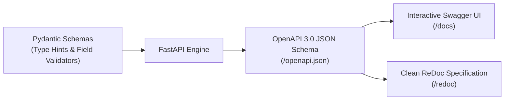
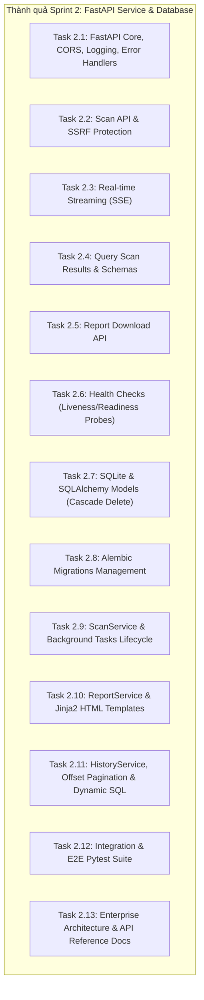

# Task 2.13: API Documentation & Architecture Design

## 1. Mục tiêu bài học (Learning Objectives)
- Hiểu và áp dụng các tiêu chuẩn thiết kế kiến trúc phần mềm doanh nghiệp (Enterprise Architecture Design) và mô hình C4 (Context, Containers, Components, Code).
- Nắm vững cách xây dựng tài liệu đặc tả API chuẩn quốc tế theo chuẩn OpenAPI 3.0 (Swagger / ReDoc) và RFC 7807 (Problem Details for HTTP APIs).
- Thành thạo kỹ thuật vẽ sơ đồ hệ thống bằng mã nguồn (Diagrams as Code) sử dụng **Mermaid.js** để tích hợp trực tiếp vào tài liệu Markdown trên GitHub/GitLab.
- Nắm vững các kiến trúc bảo mật cốt lõi trong ứng dụng Backend: Phòng thủ SSRF (Server-Side Request Forgery), Distributed Tracing với Correlation ID, và bất đồng bộ hóa với Server-Sent Events (SSE).
- Tổng kết toàn bộ kiến thức chuyên sâu của **Sprint 2: FastAPI Service & Database**.

---

## 2. Lý thuyết chuyên sâu & Khái niệm nền tảng

### 2.1. Vấn đề "Documentation Drift" và giải pháp Contract-First với FastAPI
Trong phát triển phần mềm truyền thống, tài liệu API (Word, PDF, Postman Collection thủ công) thường nhanh chóng bị lỗi thời so với code thực tế (gọi là hiện tượng **Documentation Drift**).

FastAPI giải quyết triệt để vấn đề này nhờ cơ chế **Code-First / Contract-Generated**:
- FastAPI tận dụng Python Type Hints và Pydantic Models để tự động suy diễn kiểu dữ liệu.
- Trong thời gian thực thi (Runtime), FastAPI trích xuất metadata và sinh ra tệp đặc tả JSON chuẩn **OpenAPI 3.0**.
- Swagger UI (`/docs`) và ReDoc (`/redoc`) được render trực tiếp từ OpenAPI schema này, đảm bảo tài liệu luôn đồng bộ 100% với code.



### 2.2. Sơ đồ hóa bằng mã (Diagrams as Code) với Mermaid.js
Thay vì vẽ ảnh PNG tĩnh khó chỉnh sửa qua Photoshop hay Draw.io, chuẩn DevSecOps hiện đại ưu tiên **Mermaid.js**:
1. **Quản lý phiên bản bằng Git**: Mọi thay đổi về kiến trúc đều được review qua Pull Request dưới dạng text diff.
2. **Hiển thị trực tiếp**: GitHub, GitLab, VS Code, Notion đều hỗ trợ render Markdown chứa khối ` ```mermaid ` gốc.
3. **Các loại sơ đồ phổ biến**:
   - `flowchart`: Sơ đồ luồng dữ liệu và phân lớp kiến trúc.
   - `sequenceDiagram`: Sơ đồ tuần tự thể hiện tương tác thời gian thực giữa các thành phần.
   - `erDiagram`: Sơ đồ quan hệ thực thể cơ sở dữ liệu.

### 2.3. Lựa chọn công nghệ Real-time: SSE vs WebSockets vs Long-Polling
Trong các hệ thống phân tích an ninh mạng, client cần biết tiến trình từng bước (ví dụ: đang kiểm tra Headers -> Cookies -> SSL).

| Tiêu chí | Server-Sent Events (SSE) | WebSockets | HTTP Long-Polling |
|---|---|---|---|
| **Giao thức** | HTTP/1.1 hoặc HTTP/2 tiêu chuẩn | WebSocket Protocol (`ws://`, `wss://`) qua HTTP Upgrade | HTTP tiêu chuẩn |
| **Hướng truyền** | Một chiều: Server -> Client | Hai chiều: Server <-> Client | Giả lập một chiều qua request lặp |
| **Phức tạp hạ tầng** | Rất thấp (hoạt động tốt qua Proxy, Nginx, CDN, Firewall) | Trung bình - Cao (cần cấu hình proxy bypass, sticky sessions) | Thấp nhưng tốn tài nguyên máy chủ |
| **Tự động kết nối lại** | Có sẵn trong trình duyệt (`EventSource.reconnect`) | Phải tự code logic reconnect | Phải tự code vòng lặp request |
| **Định dạng dữ liệu** | Text / JSON theo chuẩn `data: ...\n\n` | Text hoặc Binary | JSON |
| **Độ phù hợp WebGuard** | ⭐ **Hoàn hảo** (tiến trình quét chỉ cần bắn từ server về client) | Dư thừa (không cần client gửi dữ liệu ngược lại) | Không tối ưu (overhead cao) |

---

## 3. Tổng kết Kiến trúc & Các Giải pháp đã triển khai trong Sprint 2

Trong suốt Sprint 2, chúng ta đã kiến tạo hoàn chỉnh một hệ sinh thái Backend vững chắc:



### Các nguyên tắc thiết kế quan trọng đã đạt được:
1. **Phân tách trách nhiệm (Separation of Concerns)**:
   - `Routers`: Chỉ làm nhiệm vụ tiếp nhận HTTP request, validate schema đầu vào và trả về HTTP response.
   - `Services`: Nơi chứa toàn bộ logic nghiệp vụ (business rules, background task management, transaction rollback).
   - `Models & DB`: Chỉ định nghĩa cấu trúc dữ liệu và quan hệ cơ sở dữ liệu.
2. **An toàn kiểu dữ liệu (Strict Typing)**:
   - Sử dụng Type Annotations trên 100% hàm và biến, không để lọt cảnh báo Pylance/Pyright.
3. **Khả năng kiểm thử (Testability)**:
   - 83/83 bài kiểm thử tự động đạt 92% coverage, mô phỏng từ cấp độ đơn vị (Unit) tới toàn trình (E2E Integration).

---

## 4. Bộ câu hỏi phỏng vấn chuẩn Senior Backend / DevSecOps

### Q1: Tại sao WebGuard lại cần bảo vệ SSRF khi tiếp nhận URL quét? Cơ chế phòng thủ cụ thể là gì?
> **Trả lời:**
> Khi ứng dụng web cho phép người dùng chỉ định một URL để máy chủ gửi request đến (như tính năng quét an ninh của WebGuard), kẻ tấn công có thể lợi dụng máy chủ làm bàn đạp để gửi request đến mạng nội bộ công ty (Intranet), truy cập địa chỉ Loopback (`127.0.0.1`), metadata server trên cloud (`169.254.169.254`) hoặc các dịch vụ nhạy cảm như Redis, Database. Đây là lỗ hổng **SSRF (Server-Side Request Forgery)**.
>
> WebGuard phòng thủ bằng cách phân giải DNS của hostname thông qua `socket.getaddrinfo`, sau đó kiểm tra đối chiếu qua thư viện `ipaddress`:
> - Chặn mọi địa chỉ thuộc dải mạng nội bộ (Private RFC 1918: `10.0.0.0/8`, `172.16.0.0/12`, `192.168.0.0/16`).
> - Chặn Loopback (`127.0.0.0/8`, `localhost`).
> - Chặn Link-local và Cloud Metadata (`169.254.0.0/16`).
> - Chỉ cho phép scheme `http` và `https`.

### Q2: Trong FastAPI, khi nào nên sử dụng `BackgroundTasks` và khi nào nên sử dụng `asyncio.create_task`?
> **Trả lời:**
> - `BackgroundTasks` của FastAPI/Starlette phù hợp cho các tác vụ "fire-and-forget" đơn giản diễn ra ngay sau khi response được trả về (ví dụ: ghi log audit, gửi email thông báo). Tuy nhiên, nó bị gắn chặt với vòng đời của request và **không hỗ trợ hủy bỏ (cancel)** từ xa.
> - `asyncio.create_task` lên lịch một coroutine chạy độc lập ngay lập tức trên event loop hiện tại và trả về đối tượng `asyncio.Task`. Nhờ giữ tham chiếu của `Task` này trong một dictionary quản lý (`_active_tasks`), ta có thể chủ động gọi `task.cancel()` khi người dùng gửi yêu cầu hủy (Cancel Scan API), hỗ trợ cơ chế cooperative cancellation mượt mà.

### Q3: Làm thế nào để đảm bảo tính toàn vẹn dữ liệu (Data Consistency) khi xóa một bản ghi có dữ liệu quan hệ trong SQLite?
> **Trả lời:**
> Trong mô hình One-to-Many giữa `scans` và `findings`, khi xóa một phiên quét, các phát hiện con (`findings`) không được phép bị mồ côi (orphaned records).
> Giải pháp:
> 1. Thiết lập khóa ngoại `ForeignKey("scans.id", ondelete="CASCADE")` ở tầng DDL trong migration Alembic.
> 2. Cấu hình `relationship("FindingModel", cascade="all, delete-orphan", passive_deletes=True)` ở tầng SQLAlchemy ORM.
> 3. Kích hoạt PRAGMA foreign keys trong SQLite engine: `PRAGMA foreign_keys=ON`.

---

## 5. Key Takeaways & Hành trang sang Sprint 3
- Đã hoàn thành toàn bộ tài liệu kiến trúc [`docs/ARCHITECTURE.md`](file:///d:/HuyMai/SelfLearning/Project/WebGuard/docs/ARCHITECTURE.md) và đặc tả API [`docs/API_REFERENCE.md`](file:///d:/HuyMai/SelfLearning/Project/WebGuard/docs/API_REFERENCE.md).
- Mã nguồn backend sạch sẽ, không lỗi type linter, 83 tests pass 100%.
- **Chính thức khép lại Sprint 2!** Sẵn sàng chuyển hướng sang **Sprint 3: Frontend Dashboard & Visualization** (React + Vite + Tailwind CSS + Lucide Icons + Recharts).
